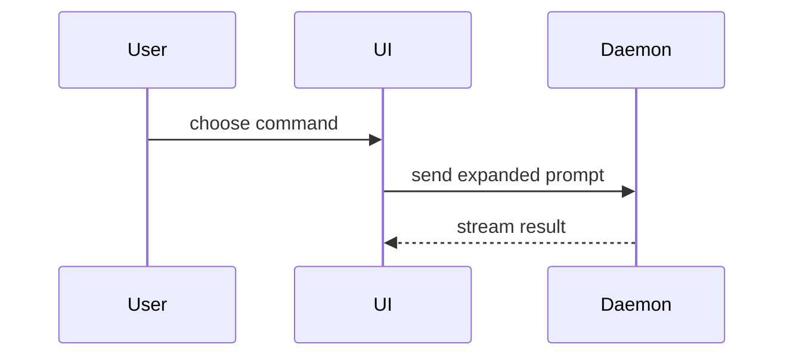

Third-party attribution: the Summary visual guidance is adapted from
Dex Horthy / HumanLayer's `show-me` skill. See [CREDITS.md](CREDITS.md) and
[LICENSE.humanlayer](LICENSE.humanlayer) for its source and MIT notice.

## Collection policy

Activate this skill only after the user explicitly requests it or accepts a recommendation. Recommendations are allowed; wait for acceptance before activating **any supporting skill**, including from a handoff, note or another skill. Reading a candidate for comparison does not authorize executing it. Skill references below are recommendations, never automatic calls. The user-authorized exception is `post-mortem`: it may automatically record unexpected failures and consult recovery history without activating another workflow.

Follow applicable user and project rules, existing documentation and artifact locations, and the canonical project workspace. Do not create parallel guidance or silently replace existing skills. Use the project's established context sources and normal filesystem tools. Delegate only when authorized and useful.

Put all agent working files in the active project or working folder's primary `.codex/` directory. Remove your temporary scripts, dependencies, captures, logs and intermediates when no longer needed, before reporting completion. Only intended deliverables and maintained project source belong elsewhere. Preserve user-owned and unrelated files; explain any working material retained for unfinished work or reproducibility.

Use short slash names in user-facing recommendations and usage examples, such as `/diagnose-bugs` or `/grilling`; do not require users to type a `gonzo-skills:` prefix. In the desktop app these select skills through the slash menu. Mention the collection name only when needed to distinguish duplicate entries. User acceptance still gates each supporting workflow.

When gathering user input, ask one concise question, optionally give a recommendation, and wait for the answer before asking the next. Do not hide several independent questions inside one sentence or form. Reuse settled answers. This governs the live interview; a requested questionnaire or specification may contain multiple questions or requirements as its deliverable.

Keep secrets out of commands shown to the user and saved artifacts. Use research and browser tools permitted by the active project and user. External publishing and production changes require the applicable user authorization and a concrete reviewable result first. Do not infer that acceptance of this workflow authorizes unrelated writes.

For any user-assisted action, first explain the single action needed, ask whether the user is ready, and stop. Only after explicit readiness request the action and begin dependent capture, monitoring or interactive work. Then stop and wait for completion or the actual result; silence and elapsed time are not completion. Allow adequate time without an arbitrary short timeout.

Use this template for writing the PR body:

```markdown
## Summary

<diagram, diff-sketch, or tree>

## Evidence

- **Before:** <screenshot/output/failing test run>
  **After:** <screenshot/output/passing test run>

## Merge Danger

**Door:** <one-way or two-way>

<optional: description>

**Blast Radius:** <one-word description>

<optional: potential ramifications of merge>
```

## Sections

Skip all preambles and keep prose brief. Use the user's domain language from `GLOSSARY.md`.

### Summary

Pick the smallest view that makes the key point clear.

- Show logic or an algorithm as pseudocode:

```text
on(save)
  if content is unchanged
    return cached result
  write new content
  return fresh result
```

- Show runtime control flow as a call tree:

```text
submitForm
  createSession
    persistPrompt
    launchAgent
  navigateToSession
```

- Show UI structure as a component tree, including state and module boundaries that matter:

```text
<SessionPage> (apps/example/src/routes/session.tsx)
  useSessionEvents()
  <SessionToolbar>
    <RunSkillButton> (packages/ui)
```

- Show file responsibility or a broad refactor as a shallow file tree:

```text
src/
├── commands/       # parses user actions
├── sessions/       # owns session state
└── transport/      # sends API requests
```

- Show component interaction, control flow, or data flow with Mermaid:



- Use `diff` when the point is what changes and the surrounding shape already exists. Match the diff shape to the topic.

For a component change:

```diff
 <SessionPage>
   useSessionEvents()
   <SessionToolbar>
+    <RunSkillButton />
   <SessionTimeline>
+    <SkillResultCard />
```

For a file-layout change:

```diff
 src/
 ├── commands/
+│   └── show-me.ts       # expands the slash command
 ├── sessions/
-└── transport.ts
+└── transport/
+    ├── client.ts
+    └── stream.ts
```

For a call-tree or call-stack change:

```diff
 submitForm
   createSession
     persistPrompt
+    expandSkillMention
     launchAgent
-  navigateToSession
+  navigateToSession
+    subscribeToEvents
```

For a state or control-flow change:

```diff
 on(save)
-  write content
+  if content is unchanged
+    return cached result
+  write new content
+  invalidate cache
```

- Show the whole block when most of it is new, when omitted context would hide ownership or order, or when the user needs a copyable target shape:

```ts
function expandSkill(command: string): string {
  const skillName = command.slice(1);
  return `use the ${skillName} skill`;
}
```

#### Guidance

Place each visual next to the short text it supports. Keep only the calls, files, props, states, and boundaries needed to answer the user's current question or the options to resolve the current discussion point.

You may use one of these, you may use several, it is unlikely you will use all of them. Use your judgement and don't overwhelm the user.

### Evidence

Concrete evidence that the change works. Show a before and after.

Screenshots are S-tier - when the environment is set up for it and the change is visual.

Execution-based evidence is A-tier. Test results, console output. Show the exact test that now fails and passes, using pseudocode.

### Merge Danger

Describe whether it's a one-way or two-way door. You can walk back through two-way doors, but not one-way doors. A PR that is cheap to roll back is lower risk. Changes that involve destructive actions or hard-to-reverse decisions are one-way doors.

The blast radius is the potential impact or scope of the changes introduced by this PR. Consider all possibilities. Examples are layout shift, breakages for consumers, mobile responsiveness, etc.
